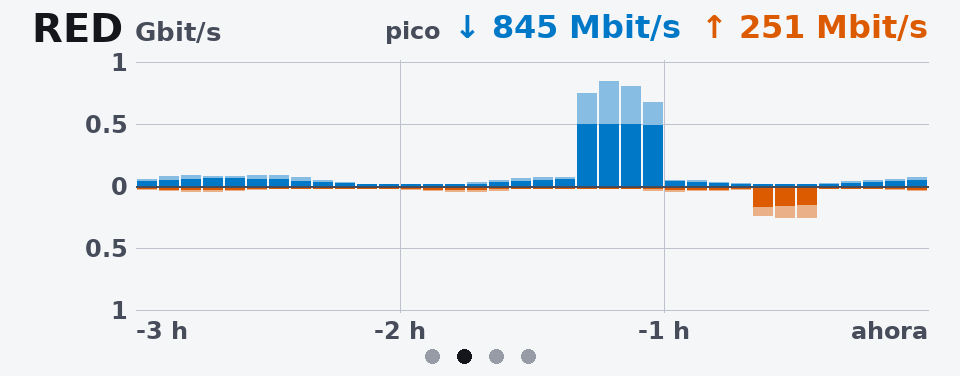
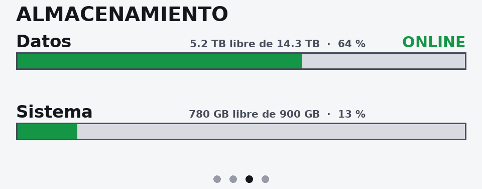
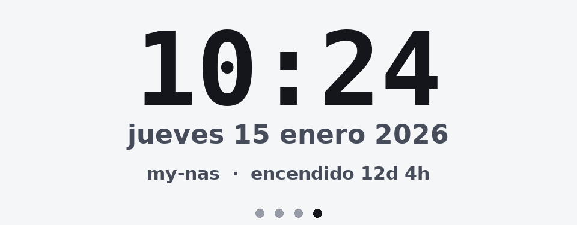

# aoostar-lcd-cards

*[Read in English](README.md)*

Tarjetas de estado configurables para la pantalla LCD USB de 960x376 del frente de los mini PC
y NAS AOOSTAR (WTR MAX, GEM12+ PRO). Eliges qué tarjetas aparecen, en qué orden y cuánto
dura cada una, y puedes escribir las tuyas. Los cuadros se dibujan en Python y se envían a la
pantalla con [asterctl](https://github.com/zehnm/aoostar-rs).



| | |
|---|---|
|  |  |
|  |  |
|  |  |

Todas las capturas se generan con datos sintéticos (`aoostar-lcd preview`). La galería
completa está en [`docs/index.html`](docs/index.html).

## Qué hace

- Tarjetas incluidas: **cpu** (carga, temperatura, historial de 3 h con picos), **memory**
  (RAM, ARC de ZFS, swap), **network** (histograma espejo de 3 h, agregado o por interfaz, en
  Mbit/s o MB/s), **temperature** (sensores hwmon, SMART, archivos), **storage** (puntos de
  montaje y pools ZFS con su salud), **clock**, **uptime**, **custom** (un comando o un
  archivo JSON/texto) e **image** (tu logo o una carpeta de imágenes).
- **Tarjetas propias** con pocas líneas de Python (`type: plugin`).
- Un solo archivo YAML: orden, duración, unidades (Mbit/s o MB/s, TB o TiB), umbrales,
  colores, fuentes, idioma (inglés, español), resolución y dispositivo. Los errores de
  configuración indican exactamente qué clave está mal.
- Corre como **un solo proceso en el equipo**, o **separado**: el colector en el host y la
  pantalla en un LXC de Proxmox o en un contenedor, unidos por un archivo JSON.
- **Vista previa sin hardware**: genera un PNG por tarjeta.
- Franja roja de alerta sobre todas las tarjetas cuando algo requiere atención (un pool ZFS
  degradado) y pantalla SIN DATOS cuando dejan de llegar métricas.

## Compatibilidad

- Pantalla: la LCD USB serie `0416:90a1` (normalmente `/dev/ttyACM0`) del **AOOSTAR WTR MAX**;
  asterctl también apunta al GEM12+ PRO. Los diseños están pensados para 960x376.
- Equipo: Linux con Python 3.11 o superior. Las métricas salen de psutil y de `/sys`; ZFS y
  SMART necesitan `zfs`/`zpool` y `smartctl`.
- asterctl: v0.2.0 (fijada en [`asterctl.version`](asterctl.version)), Linux.

> **Estado**: todo, salvo el último paso hacia la pantalla, tiene pruebas automáticas (vistas
> previas, colector, configuración, el envoltorio de asterctl con un binario falso y
> `asterctl --simulate` en CI). El envío real de cuadros a la pantalla depende de asterctl y
> hay que comprobarlo en el hardware.

## Prueba rápida sin hardware

```sh
python3 -m venv ~/.venvs/aoostar-lcd
~/.venvs/aoostar-lcd/bin/pip install git+https://github.com/<tu-usuario>/aoostar-lcd-cards   # o: pip install .
~/.venvs/aoostar-lcd/bin/aoostar-lcd preview --out /tmp/tarjetas           # tarjetas de demostración
~/.venvs/aoostar-lcd/bin/aoostar-lcd preview -c config.yaml --out /tmp/tarjetas --live   # tu equipo
```

## Instalación en el equipo con la pantalla (un solo proceso)

1. **asterctl** (ver la sección [asterctl](#asterctl)):

   ```sh
   git clone https://github.com/<tu-usuario>/aoostar-lcd-cards && cd aoostar-lcd-cards
   sudo scripts/install-asterctl.sh          # release fijado + SHA-256, o compilación con cargo
   asterctl --version                        # asterctl 0.2.0
   ```

2. **El paquete**, en su propio entorno virtual (Debian 12 y 13 no permiten pip en el sistema):

   ```sh
   sudo python3 -m venv /opt/aoostar-lcd
   sudo /opt/aoostar-lcd/bin/pip install .
   sudo ln -sf /opt/aoostar-lcd/bin/aoostar-lcd /usr/local/bin/aoostar-lcd
   ```

3. **Configuración**:

   ```sh
   sudo install -d /etc/aoostar-lcd
   sudo cp config.example.yaml /etc/aoostar-lcd/config.yaml   # edítala
   sudo aoostar-lcd check -c /etc/aoostar-lcd/config.yaml
   ```

4. **Regla udev opcional** para tener siempre `/dev/aoostar-lcd`:
   `sudo cp udev/99-aoostar-lcd.rules /etc/udev/rules.d/ && sudo udevadm control --reload && sudo udevadm trigger`.

5. **systemd**:

   ```sh
   sudo cp systemd/aoostar-lcd.service /etc/systemd/system/
   sudo systemctl daemon-reload && sudo systemctl enable --now aoostar-lcd.service
   journalctl -u aoostar-lcd -f
   ```

La unidad corre como root porque `smartctl` y `zpool` lo necesitan, con restricciones de
systemd (`ProtectSystem=strict`, `NoNewPrivileges`...). Si no usas SMART ni ZFS puedes
correrla con un usuario normal del grupo `dialout` (ver los comentarios de la unidad).

## Modo separado y LXC de Proxmox

El colector corre en el host de Proxmox (ve todas las NIC, los pools y los discos) y escribe
`/run/aoostar-lcd/state.json`; un LXC sin privilegios lo lee y maneja la pantalla.

**En el host** (instala el paquete como arriba; ahí no hace falta asterctl):

```sh
sudo cp systemd/aoostar-lcd-collector.service /etc/systemd/system/
sudo systemctl daemon-reload && sudo systemctl enable --now aoostar-lcd-collector.service
```

**Configuración del contenedor** (`/etc/pve/lxc/<id>.conf`, Proxmox VE 8.1 o posterior):

```
dev0: /dev/ttyACM0,gid=20,mode=0660
mp0: /run/aoostar-lcd,mp=/data,ro=1
```

`gid=20` es `dialout` en los contenedores Debian. En versiones anteriores de Proxmox usa
`lxc.cgroup2.devices.allow: c 166:* rwm` y
`lxc.mount.entry: /dev/ttyACM0 dev/ttyACM0 none bind,optional,create=file` en lugar de `dev0`.
El colector arranca antes que los contenedores (la unidad tiene `Before=pve-guests.service`).

**Dentro del contenedor**: instala asterctl y el paquete, copia el mismo archivo de
configuración (ahí solo importan `display` y la lista de tarjetas) y activa
`systemd/aoostar-lcd-display.service`, que lee `/data/state.json` y corre con un usuario
dinámico sin privilegios dentro de `dialout`.

## Docker

```sh
cp config.example.yaml config.yaml          # edítala; deja display.device: /dev/ttyACM0
docker compose up -d --build                # compila asterctl desde el commit fijado
# o asterctl precompilado (x86_64): docker build --build-arg ASTERCTL_SOURCE=release -t aoostar-lcd .
```

El contenedor corre con un usuario sin privilegios; solo recibe `--device /dev/ttyACM0` y el
grupo `dialout`. Necesita `network_mode: host` para ver las NIC reales y un montaje de solo
lectura de lo que quieras medir (`/:/hostfs:ro` y luego `{mount: /hostfs}`). ZFS y SMART
necesitan herramientas del host: para eso, corre el colector en el host y el servicio
`display` de `docker-compose.yml` (perfil `split`).

## Configuración

Ver [`config.example.yaml`](config.example.yaml): cada opción está comentada ahí.
`aoostar-lcd check` valida un archivo y señala la clave exacta que está mal.

| Sección | Claves |
|---|---|
| `language` | `en` o `es` (palabras que se dibujan en las tarjetas) |
| `display` | `backend` (`asterctl`, `png`, `none`), `device` o `usb`, `asterctl` (ruta), `timeout`, `simulate`, `width`, `height`, `frame_interval`, `png_dir` |
| `collector` | `interval`, `state_file`, `history_file`, `max_age` |
| `rotation` | `default_duration`, `page_dots`, `alert_banner` |
| `theme` | `preset` (`dark`, `light`), `colors` (background, text, muted, dim, track, grid, ok, warn, crit, rx, tx, accent), `fonts` (`sans`, `mono`) |
| `cards` | lista; el orden es el de la rotación |

Todas las tarjetas aceptan `type`, `id`, `title`, `duration` (segundos), `enabled` y
`refresh` (segundos entre mediciones). Opciones de cada tarjeta:

| Tarjeta | Opciones |
|---|---|
| `cpu` | `temperature_chip` (`auto`, `k10temp`, `coretemp`... o `null`), `temperature_sensor`, `temperature_unit`, `history_minutes` (0 = sin gráfico), `bucket_seconds`, `warn`, `crit`, `temp_warn`, `temp_crit` |
| `memory` | `units` (`iec` GiB, `si` GB), `zfs_arc` (`auto`, true, false), `swap`, `warn`, `crit` |
| `network` | `interfaces` (`auto` o una lista), `exclude`, `mode` (`aggregate`, `split`), `units` (`bits`, `bytes`), `history_minutes`, `bucket_seconds`, `min_scale`, `show_peaks`, `labels` |
| `temperature` | `sensors` (lista de `{label, chip \| smart \| file, sensor, aggregate, scale, warn, crit}`; sin ella muestra todos los sensores que encuentra), `units`, `warn`, `crit`, `smart_refresh` |
| `storage` | `volumes` (hasta 4 `{mount: /ruta}` o `{zfs: pool}`, con `label` opcional), `units` (`si` TB, `iec` TiB), `warn`, `crit`, `big` (`free`, `used`) |
| `clock` | `time_format`, `date_format`, `timezone`, `show_hostname`, `show_uptime`, `hostname` |
| `uptime` | `hostname`, `load_warn`, `load_crit` (por núcleo) |
| `custom` | `command` o `file`, `format` (`auto`, `json`, `text`), `timeout`, `fields`, `max_bytes` |
| `image` | `path` (archivo o carpeta), `mode` (`contain`, `cover`, `fit-width`), `background`, `per_visit` (`all`, `one`), `upscale`, `max_file_mb`, `max_pixels`, `max_files` |
| `plugin` | `plugin: ruta/archivo.py:Clase` o `modulo:Clase`, más las opciones propias del plugin |

## Tarjetas e imágenes propias

- **Sin programar**: `type: custom` muestra lo que imprime un comando (JSON o texto) o lo que
  contiene un archivo.
- **Imágenes**: `type: image` con un archivo o una carpeta; respeta la transparencia, relee
  la carpeta en cada vuelta y omite los archivos dañados. *Usa solo imágenes sobre las que
  tengas derechos; el proyecto no incluye arte de terceros.*
- **Python**: una subclase de `aoostar_lcd.Card` (`collect()` + `render(canvas, theme, data)`).

Todo está explicado en [docs/CUSTOM_CARDS.md](docs/CUSTOM_CARDS.md) (en inglés), con ejemplos
en [`examples/`](examples/).

## asterctl

[asterctl](https://github.com/zehnm/aoostar-rs), de Markus Zehnder, es la herramienta que habla
con la pantalla. Su protocolo se obtuvo por ingeniería inversa del software del fabricante; el
autor advierte que un comando incorrecto puede colgar el firmware de la pantalla hasta que se
apague y se vuelva a encender.

- **Licencia**: MIT OR Apache-2.0. No se copia en este repositorio; sus textos de licencia
  están en [`licenses/asterctl/`](licenses/asterctl/) y se instalan junto al binario.
- **Versión fijada**: [`asterctl.version`](asterctl.version) (tag `v0.2.0`, commit `078dc267`,
  SHA-256 del release para Linux x64). Lo leen el instalador, el Dockerfile y CI; CI además
  comprueba que el tag siga apuntando a ese commit.
- **Instalación**: `scripts/install-asterctl.sh` (idempotente; `--from release` verifica el
  SHA-256, `--from source` ejecuta `cargo install --locked --rev <commit>`; `--prefix` para
  instalar sin root), el Dockerfile o el paquete de tu sistema (FreeBSD ports, nixpkgs).
- **Comprobación**: `aoostar-lcd check` verifica que asterctl exista y sea 0.2.0 o posterior.
  Si la pantalla deja de responder, apágala y vuelve a encenderla antes de cambiar otra cosa.
- `aoostar-lcd screen off` / `on` apagan o encienden la pantalla a través de asterctl.

## Solución de problemas

| Síntoma | Qué revisar |
|---|---|
| `SIN DATOS (state is N s old)` | El colector no corre o no puede escribir `state_file`; en modo separado, el montaje del contenedor. |
| `Permission denied` en `/dev/ttyACM0` | El usuario no está en `dialout`, o a la entrada `dev0` del LXC le falta `gid=20`. |
| `asterctl timed out` | Otro proceso tiene abierto el puerto serie, o la pantalla necesita reiniciarse. |
| Una tarjeta muestra una línea roja abajo | Falló su `collect()`; el texto es el error (también queda en el log). |
| Las temperaturas salen como `-` | El nombre de `chip` no existe: lístalos con `python3 -c "import psutil; print(psutil.sensors_temperatures().keys())"`. |

## Desarrollo

```sh
python3 -m venv .venv && .venv/bin/pip install -e ".[dev]"
.venv/bin/ruff check . && .venv/bin/ruff format --check .
.venv/bin/python -m pytest -q          # no necesita hardware
sh scripts/make-screenshots.sh         # regenera docs/img con datos sintéticos
```

Ver [CONTRIBUTING.md](CONTRIBUTING.md) y [docs/DESIGN.md](docs/DESIGN.md).

## Licencia

MIT, ver [LICENSE](LICENSE). Fuentes DejaVu incluidas y avisos de terceros: [NOTICE](NOTICE).
AOOSTAR, WTR MAX y GEM12+ PRO son nombres de sus respectivos dueños; este proyecto no está
afiliado a ellos ni cuenta con su respaldo.
