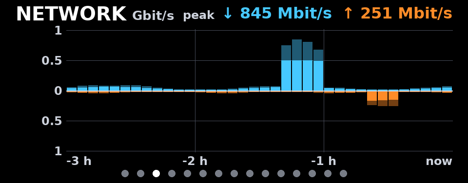
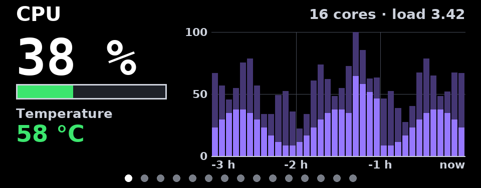
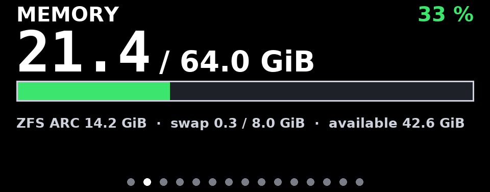
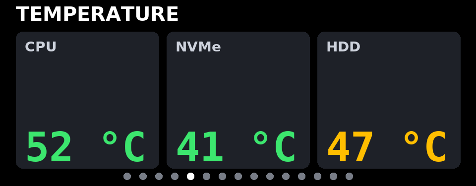
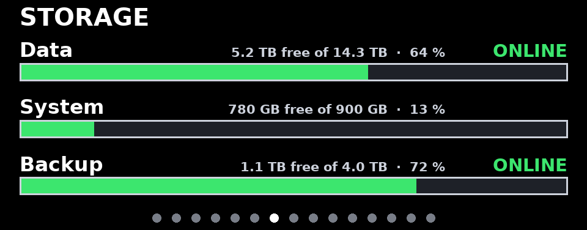
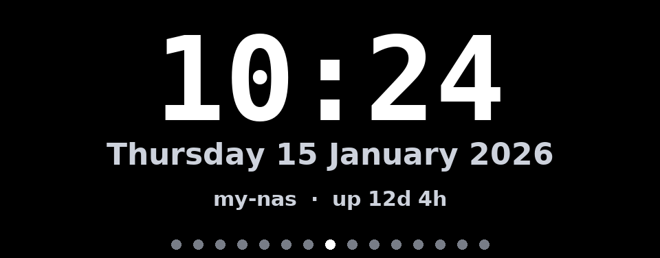

# aoostar-lcd-cards

*[Leer en español](README.es.md)*

Configurable status cards for the 960x376 USB LCD on the front of AOOSTAR mini PCs and NAS
boxes (WTR MAX, GEM12+ PRO). You choose which cards appear, in which order and for how
long; you can write your own. Frames are drawn in Python and sent to the panel with
[asterctl](https://github.com/zehnm/aoostar-rs).



| | |
|---|---|
|  |  |
|  |  |
|  |  |

All screenshots are generated with synthetic data (`aoostar-lcd preview`). The full
gallery is in [`docs/index.html`](docs/index.html).

## Features

- Built-in cards: **cpu** (load, temperature, 3 h history with peaks), **memory** (RAM, ZFS
  ARC, swap), **network** (3 h mirrored histogram, aggregated or per interface, Mbit/s or
  MB/s), **temperature** (hwmon chips, SMART, files), **storage** (mount points and ZFS
  pools with health), **clock**, **uptime**, **custom** (a command or a JSON/text file) and
  **image** (your logo or a folder of pictures).
- **Your own cards** in a few lines of Python (`type: plugin`).
- One YAML file: order, duration, units (Mbit/s vs MB/s, TB vs TiB), thresholds, colors,
  fonts, language (English, Spanish), resolution and device. Clear validation errors.
- Runs as **one process on the host**, or **split**: collector on the host, display in a
  Proxmox LXC or a container, connected by a JSON file.
- **Preview without hardware**: render every card to PNG.
- Red alert banner on every card when something needs attention (a degraded ZFS pool), and a
  NO DATA screen when metrics stop arriving.

## Compatibility

- Panel: the USB serial LCD `0416:90a1` (usually `/dev/ttyACM0`) of the **AOOSTAR WTR MAX**;
  asterctl also targets the GEM12+ PRO. The layouts are designed for 960x376.
- Host: Linux with Python 3.11+. Metrics come from psutil and `/sys`; ZFS and SMART need
  `zfs`/`zpool` and `smartctl`.
- asterctl: v0.2.0 (pinned in [`asterctl.version`](asterctl.version)), Linux.

> **Status**: everything except the final hop to the panel is covered by automated tests
> (previews, collector, configuration, asterctl wrapper with a fake binary, and
> `asterctl --simulate` in CI). Sending frames to a real panel depends on asterctl and has
> to be checked on the hardware.

## Quick start: preview without hardware

```sh
python3 -m venv ~/.venvs/aoostar-lcd
~/.venvs/aoostar-lcd/bin/pip install git+https://github.com/<you>/aoostar-lcd-cards   # or: pip install .
~/.venvs/aoostar-lcd/bin/aoostar-lcd preview --out /tmp/cards            # demo cards, fake data
~/.venvs/aoostar-lcd/bin/aoostar-lcd preview -c config.yaml --out /tmp/cards --live   # your machine
```

## Install on the machine with the LCD (single process)

1. **asterctl** (see [asterctl](#asterctl) below):

   ```sh
   git clone https://github.com/<you>/aoostar-lcd-cards && cd aoostar-lcd-cards
   sudo scripts/install-asterctl.sh          # pinned release + SHA-256 check, or cargo build
   asterctl --version                        # asterctl 0.2.0
   ```

2. **The package** in its own virtual environment (Debian 12/13 forbid system-wide pip):

   ```sh
   sudo python3 -m venv /opt/aoostar-lcd
   sudo /opt/aoostar-lcd/bin/pip install .
   sudo ln -sf /opt/aoostar-lcd/bin/aoostar-lcd /usr/local/bin/aoostar-lcd
   ```

3. **Configuration**:

   ```sh
   sudo install -d /etc/aoostar-lcd
   sudo cp config.example.yaml /etc/aoostar-lcd/config.yaml   # edit it
   sudo aoostar-lcd check -c /etc/aoostar-lcd/config.yaml
   ```

4. **Optional udev rule** for a stable `/dev/aoostar-lcd` name:
   `sudo cp udev/99-aoostar-lcd.rules /etc/udev/rules.d/ && sudo udevadm control --reload && sudo udevadm trigger`.

5. **systemd**:

   ```sh
   sudo cp systemd/aoostar-lcd.service /etc/systemd/system/
   sudo systemctl daemon-reload && sudo systemctl enable --now aoostar-lcd.service
   journalctl -u aoostar-lcd -f
   ```

The unit runs as root because `smartctl` and `zpool` need it; it is hardened
(`ProtectSystem=strict`, `NoNewPrivileges`...). Without SMART/ZFS you can run it as a normal
user in the `dialout` group (see the comments in the unit).

## Split mode and Proxmox LXC

The collector runs on the Proxmox host (it sees every NIC, pool and disk) and writes
`/run/aoostar-lcd/state.json`; an unprivileged LXC reads it and drives the panel.

**On the host** (install the package as above; asterctl is not needed there):

```sh
sudo cp systemd/aoostar-lcd-collector.service /etc/systemd/system/
sudo systemctl daemon-reload && sudo systemctl enable --now aoostar-lcd-collector.service
```

**Container configuration** (`/etc/pve/lxc/<id>.conf`, Proxmox VE 8.1 or newer):

```
dev0: /dev/ttyACM0,gid=20,mode=0660
mp0: /run/aoostar-lcd,mp=/data,ro=1
```

`gid=20` is `dialout` in Debian containers. On older Proxmox versions use
`lxc.cgroup2.devices.allow: c 166:* rwm` and
`lxc.mount.entry: /dev/ttyACM0 dev/ttyACM0 none bind,optional,create=file` instead of `dev0`.
Start the collector before the container (the unit has `Before=pve-guests.service`).

**Inside the container**: install asterctl and the package, copy the same config file
(only `display` and the card list matter there) and enable
`systemd/aoostar-lcd-display.service`, which reads `/data/state.json` and runs as a dynamic
unprivileged user in `dialout`.

## Docker

```sh
cp config.example.yaml config.yaml          # edit; keep display.device: /dev/ttyACM0
docker compose up -d --build                # builds asterctl from the pinned commit
# or prebuilt asterctl (x86_64): docker build --build-arg ASTERCTL_SOURCE=release -t aoostar-lcd .
```

The container runs as an unprivileged user; the only access it gets is
`--device /dev/ttyACM0` plus the `dialout` group. It needs `network_mode: host` to see the
real NICs and a read-only mount of what you want to measure (`/:/hostfs:ro`, then
`{mount: /hostfs}`). ZFS and SMART need host tools: for those, run the collector on the host
and the `display` service of `docker-compose.yml` (profile `split`).

## Configuration

See [`config.example.yaml`](config.example.yaml); every option is commented there.
`aoostar-lcd check` validates a file and reports the exact key that is wrong.

| Section | Keys |
|---|---|
| `language` | `en` or `es` (words drawn on the cards) |
| `display` | `backend` (`asterctl`, `png`, `none`), `device` or `usb`, `asterctl` (path), `timeout`, `simulate`, `width`, `height`, `frame_interval`, `png_dir` |
| `collector` | `interval`, `state_file`, `history_file`, `max_age` |
| `rotation` | `default_duration`, `page_dots`, `alert_banner` |
| `theme` | `preset` (`dark`, `light`), `colors` (background, text, muted, dim, track, grid, ok, warn, crit, rx, tx, accent), `fonts` (`sans`, `mono`) |
| `cards` | list; order = rotation order |

Every card accepts `type`, `id`, `title`, `duration` (seconds), `enabled`, and `refresh`
(seconds between measurements). Card options:

| Card | Options |
|---|---|
| `cpu` | `temperature_chip` (`auto`, `k10temp`, `coretemp`... or `null`), `temperature_sensor`, `temperature_unit`, `history_minutes` (0 = no chart), `bucket_seconds`, `warn`, `crit`, `temp_warn`, `temp_crit` |
| `memory` | `units` (`iec` GiB, `si` GB), `zfs_arc` (`auto`, true, false), `swap`, `warn`, `crit` |
| `network` | `interfaces` (`auto` or a list), `exclude`, `mode` (`aggregate`, `split`), `units` (`bits`, `bytes`), `history_minutes`, `bucket_seconds`, `min_scale`, `show_peaks`, `labels` |
| `temperature` | `sensors` (list of `{label, chip \| smart \| file, sensor, aggregate, scale, warn, crit}`; omitted = every chip found), `units`, `warn`, `crit`, `smart_refresh` |
| `storage` | `volumes` (up to 4 `{mount: /path}` or `{zfs: pool}`, optional `label`), `units` (`si` TB, `iec` TiB), `warn`, `crit`, `big` (`free`, `used`) |
| `clock` | `time_format`, `date_format`, `timezone`, `show_hostname`, `show_uptime`, `hostname` |
| `uptime` | `hostname`, `load_warn`, `load_crit` (per core) |
| `custom` | `command` or `file`, `format` (`auto`, `json`, `text`), `timeout`, `fields`, `max_bytes` |
| `image` | `path` (file or folder), `mode` (`contain`, `cover`, `fit-width`), `background`, `per_visit` (`all`, `one`), `upscale`, `max_file_mb`, `max_pixels`, `max_files` |
| `plugin` | `plugin: path/file.py:Class` or `module:Class`, plus the plugin's own options |

## Your own cards and pictures

- **No code**: `type: custom` shows what a command prints (JSON or text) or what a file
  contains.
- **Pictures**: `type: image` with a file or a folder; transparency is respected, the folder
  is re-read on every pass, broken files are skipped. *Only use images you have the right to
  display; the project ships no third-party artwork.*
- **Python**: subclass `aoostar_lcd.Card` (`collect()` + `render(canvas, theme, data)`).

Everything is explained in [docs/CUSTOM_CARDS.md](docs/CUSTOM_CARDS.md), with examples in
[`examples/`](examples/).

## asterctl

[asterctl](https://github.com/zehnm/aoostar-rs) by Markus Zehnder is the tool that talks to
the panel. Its protocol was reverse-engineered from the vendor's software; the author warns
that a wrong command can hang the display firmware until it is power-cycled.

- **License**: MIT OR Apache-2.0. It is not copied into this repository; its license texts
  are in [`licenses/asterctl/`](licenses/asterctl/) and are installed next to the binary.
- **Pinned version**: [`asterctl.version`](asterctl.version) (tag `v0.2.0`, commit
  `078dc267`, SHA-256 of the Linux x64 release). The installer, the Dockerfile and CI read it;
  CI also checks that the tag still points to that commit.
- **Install**: `scripts/install-asterctl.sh` (idempotent; `--from release` checks the
  SHA-256, `--from source` runs `cargo install --locked --rev <commit>`; `--prefix` for a
  non-root install), the Dockerfile, or your distribution (FreeBSD ports, nixpkgs).
- **Check**: `aoostar-lcd check` verifies that asterctl exists and is >= 0.2.0. If the panel
  stops responding, power-cycle it before changing anything else.
- `aoostar-lcd screen off` / `on` switch the panel through asterctl.

## Troubleshooting

| Symptom | What to check |
|---|---|
| `NO DATA (state is N s old)` | The collector is not running or cannot write `state_file`; in split mode, the bind mount. |
| `Permission denied` on `/dev/ttyACM0` | The user is not in `dialout`, or the LXC `dev0` entry lacks `gid=20`. |
| `asterctl timed out` | Another process holds the serial port, or the panel needs a power cycle. |
| A card shows a red line at the bottom | Its `collect()` failed; the message is the error (also in the log). |
| Temperatures show `-` | Wrong `chip` name: list them with `python3 -c "import psutil; print(psutil.sensors_temperatures().keys())"`. |

## Development

```sh
python3 -m venv .venv && .venv/bin/pip install -e ".[dev]"
.venv/bin/ruff check . && .venv/bin/ruff format --check .
.venv/bin/python -m pytest -q          # no hardware needed
sh scripts/make-screenshots.sh         # regenerates docs/img with synthetic data
```

See [CONTRIBUTING.md](CONTRIBUTING.md) and [docs/DESIGN.md](docs/DESIGN.md).

## License

MIT, see [LICENSE](LICENSE). Bundled DejaVu fonts and third-party notices: [NOTICE](NOTICE).
AOOSTAR, WTR MAX and GEM12+ PRO are names of their respective owners; this project is not
affiliated with or endorsed by them.
